# AWS Cloud Infrastructure: EC2 Web Server Automation & Linux Administration

## Table of Contents
- [Introduction to Cloud Compute & Automation](#-introduction-to-cloud-compute--automation)
- [Project Overview](#-project-overview)
- [Objective](#-objective)
- [System Specifications & Provisioning Baseline](#️-system-specifications--provisioning-baseline)
- [Deployment & Traffic Architecture (ASCII Flowchart)](#-deployment--traffic-architecture)
- [Deployment Methodology](#-deployment-methodology)
  - [Phase 1: MFA Root Authentication & EC2 Dashboard Navigation](#phase-1-mfa-root-authentication--ec2-dashboard-navigation)
  - [Phase 2: Compute Sizing & Amazon Machine Image Selection](#phase-2-compute-sizing--amazon-machine-image-selection)
  - [Phase 3: Key Pair Association & Stateful Security Group Rules](#phase-3-key-pair-association--stateful-security-group-rules)
  - [Phase 4: Automated Cloud-Init Bootstrapping (User Data)](#phase-4-automated-cloud-init-bootstrapping-user-data)
  - [Phase 5: Instance Initialization & HTTP Endpoint Validation](#phase-5-instance-initialization--http-endpoint-validation)
  - [Phase 6: Remote SSH Administration & Terminal File Inspection](#phase-6-remote-ssh-administration--terminal-file-inspection)
  - [Phase 7: Graceful Host Shutdown & Safe Resource Decommissioning](#phase-7-graceful-host-shutdown--safe-resource-decommissioning)
- [Operational Relevance & Cloud Hygiene](#-operational-relevance--cloud-hygiene)
- [Ethical Guidelines & Disclaimer](#️-ethical-guidelines--disclaimer)

---

## Introduction to Cloud Compute & Automation
**Amazon Elastic Compute Cloud (Amazon EC2)** provides scalable on-demand compute capacity within the AWS global infrastructure. Rather than manually configuring physical hardware, cloud operators provision virtual server instances across target Virtual Private Clouds (VPCs) and Availability Zones within seconds.

A foundational capability of EC2 is **User Data bootstrapping**. By injecting cloud-init shell scripts during instance initialization, administrators can automate server package updates, service installations, daemon enablement, and static content deployment without manual post-launch configuration.

## Project Overview
This project documents the end-to-end lifecycle of an AWS EC2 instance. Using the **AWS Management Console**, an **Amazon Linux 2023** virtual machine is provisioned on a `t3.micro` instance type[cite: 124, 125]. An automated Bash user data script updates repository packages, installs the Apache HTTP server (`httpd`), enables the service unit across system reboots, and creates a static HTML document[cite: 131]. 

The lab verifies HTTP web connectivity over port 80, executes SSH administrative commands via **PuTTY** using an RSA key pair, and walks through cost-effective resource decommissioning (stopping and terminating compute instances to prevent unwanted billing)[cite: 126, 136, 137, 140, 142].

## Objective
To deploy, automate, manage, and safely decommission a cloud-hosted Linux web server in AWS, demonstrating:
1. Multi-factor authenticated access to cloud infrastructure[cite: 127].
2. Network access control using stateful security group rules (SSH, HTTP, HTTPS)[cite: 129, 130].
3. Automated provisioning via `cloud-init` shell scripts[cite: 131].
4. Secure remote shell access using key-based authentication[cite: 126, 138].
5. Clean resource lifecycle management and instance termination[cite: 133, 142].

## System Specifications & Provisioning Baseline
* **Cloud Platform:** Amazon Web Services (AWS)[cite: 124, 135]
* **Region / Availability Zone:** `us-west-2` (Oregon) / `us-west-2b`[cite: 124, 134]
* **Operating System:** Amazon Linux 2023 (Kernel 6.18, 64-bit x86, HVM EBS-backed)[cite: 124]
* **AMI Identifier:** `ami-0c766c2cff1b35ed2`[cite: 124]
* **Compute Instance Type:** `t3.micro` (2 vCPUs, 1 GiB Memory, Burstable)[cite: 125]
* **Storage Allocation:** 1 x 8 GiB gp3 Root Volume[cite: 123, 125]
* **SSH Key Pair:** `Linux-pratu` (RSA / `.pem` OpenSSH)[cite: 127, 128]
* **Web Server Daemon:** Apache HTTP Server (`httpd` 2.4)[cite: 131]
* **Inbound Access Control (Security Group):**
  * `TCP / 22` (SSH Ingress)[cite: 129]
  * `TCP / 80` (HTTP Ingress)[cite: 129]
  * `TCP / 443` (HTTPS Ingress)[cite: 130]
  * `UDP / 22` (Custom Ingress)[cite: 130]

---

## Deployment & Traffic Architecture

```text
+----------------------------------------------------------------------------------------------------+
|                                AWS EC2 WEBSERVER LIFECYCLE ARCHITECTURE                            |
+----------------------------------------------------------------------------------------------------+

   [ Internet Users / Client Browser ]                     [ Administrator Desktop (PuTTY) ]
                   |                                                       |
        (HTTP: Port 80 Ingress)                               (SSH: Port 22 Ingress + Key)
                   |                                                       |
                   v                                                       v
+----------------------------------------------------------------------------------------------------+
| AWS Region: us-west-2 (Oregon) | VPC: Default (vpc-07587356409da0db4)                              |
|                                                                                                    |
|    +------------------------------------------------------------------------------------------+    |
|    | Security Group Firewall (Inbound Rules)                                                       |
|    | - Allow TCP 22 (SSH)   <- 0.0.0.0/0                                                           |
|    | - Allow TCP 80 (HTTP)  <- 0.0.0.0/0[cite: 129]                                                  |
|    | - Allow TCP 443 (HTTPS)<- 0.0.0.0/0[cite: 130]                                                  |
|    +--------------------------------------------+---------------------------------------------+    |
|                                                 |                                                  |
|                                                 v                                                  |
|    +------------------------------------------------------------------------------------------+    |
|    | EC2 Instance: t3.micro (Amazon Linux 2023)[cite: 124, 125]                                              |
|    | Private IP: 172.31.31.91 | Public IP: Elastic/Auto-Assigned[cite: 134, 135]                             |
|    |                                                                                          |    |
|    |  +------------------------------------------------------------------------------------+  |    |
|    |  | Cloud-Init Bootstrapping (User Data Script)[cite: 131]                                        |  |    |
|    |  |  1. yum update -y                                                                 |  |    |
|    |  |  2. yum install -y httpd                                                           |  |    |
|    |  |  3. systemctl start httpd && systemctl enable httpd                                |  |    |
|    |  |  4. echo "<h1>Welcome to My AWS Webserver</h1>" > /var/www/html/index.html         |  |    |
|    |  +------------------------------------------------------------------------------------+  |    |
|    |                                            |                                             |    |
|    |                                            v                                             |    |
|    |                               [ Apache httpd Daemon Active ][cite: 131]                          |    |
|    +------------------------------------------------------------------------------------------+    |
+----------------------------------------------------------------------------------------------------+
                                                  |
                   +------------------------------+------------------------------+
                   |                                                             |
                   v                                                             v
     [ Phase 6: Terminal Verification ]                           [ Phase 7: Clean Teardown ]
     - Validate Apache HTML Directory[cite: 138]                             - Stop Instance (Conserves Cost)[cite: 140, 141]
     - Graceful System Halt (sudo init 0)[cite: 139]                         - Terminate Instance (Deletes EBS)[cite: 133, 142]
```

---

## 🚀 Deployment Methodology

### Phase 1: MFA Root Authentication & EC2 Dashboard Navigation

Navigated to the AWS Management Console sign-in portal (`aws.amazon.com/console`) and clicked **Sign in**[cite: 114].
<br>

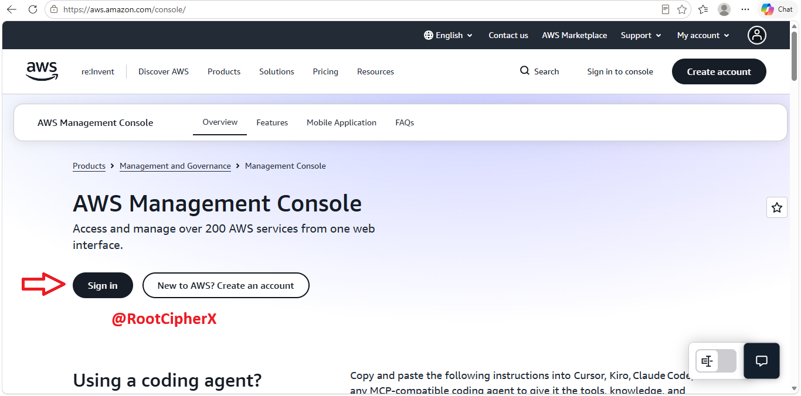

Selected the **Root user** radio button, entered the account root email, and supplied the master password[cite: 115, 116].
<br>


Submitted the password to proceed to factor verification[cite: 116].
<br>


Encountered the mandatory **Additional verification required** challenge and entered the time-sensitive 6-digit TOTP code (`189148`) from Google Authenticator[cite: 117].
<br>


Completed the security CAPTCHA verification (`4t4hsh`) to prevent automated sign-ins[cite: 118].
<br>


Authenticated into **Console Home** in the `us-west-2` (Oregon) region[cite: 119].
<br>

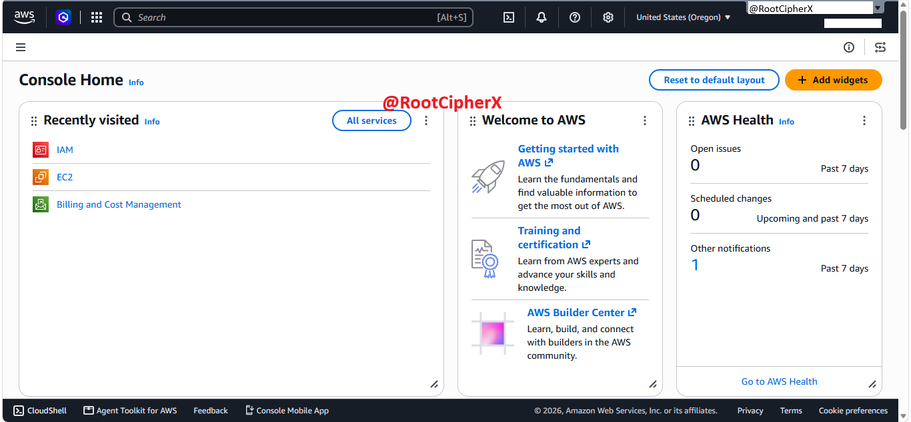

Searched for **EC2** in the global navigation bar and selected the Elastic Compute Cloud service[cite: 120].
<br>

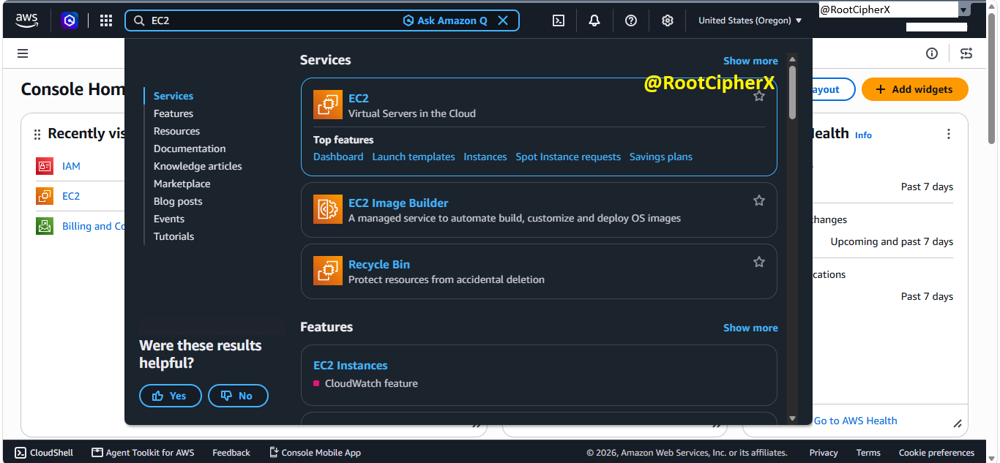

Landed on the EC2 Service Dashboard overview[cite: 121].
<br>

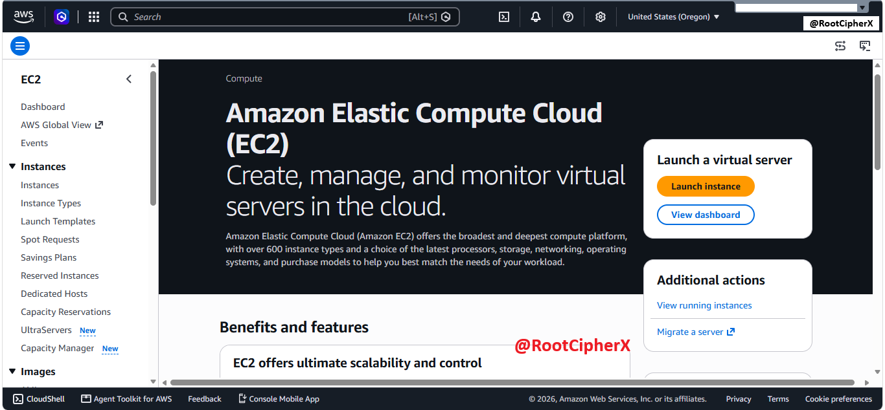

Navigated to **Instances** in the left sidebar (confirming 0 active instances running in the region) and clicked **Launch instances**[cite: 122].
<br>

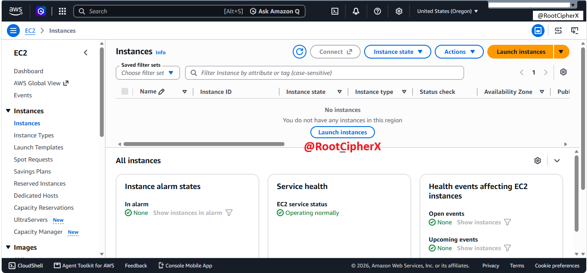

Opened the unified **Launch an instance** configuration wizard[cite: 113].
<br>

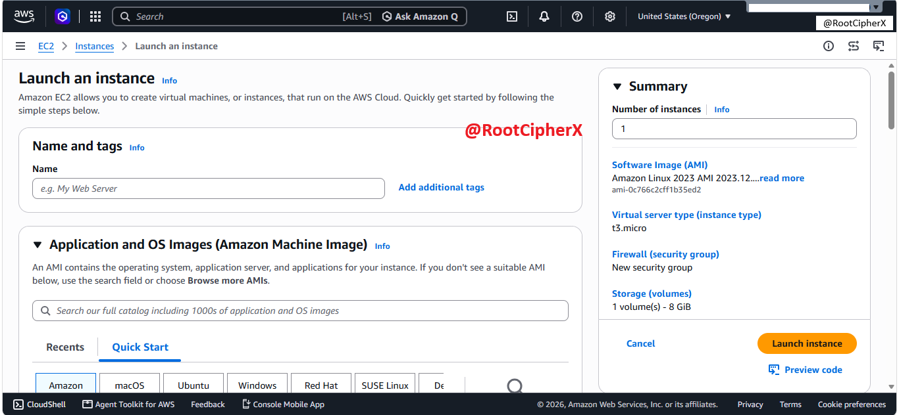

---

### Phase 2: Compute Sizing & Amazon Machine Image Selection

Under **Application and OS Images (Amazon Machine Image)**, selected **Amazon Linux** from the Quick Start catalog[cite: 124]:
* **AMI:** Amazon Linux 2023 kernel-6.18 AMI (`ami-0c766c2cff1b35ed2`)[cite: 124]
* **Architecture:** 64-bit (x86)[cite: 124]
* **Virtualization:** Hardware Virtual Machine (HVM) with EBS root volume[cite: 124]
* **Eligibility:** Free tier eligible[cite: 124]
<br>

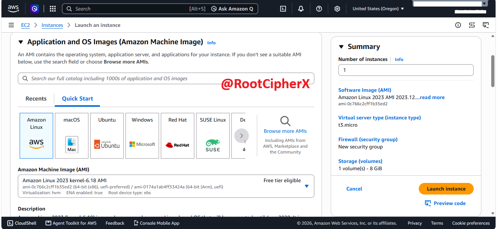

Under **Instance type**, selected the standard general-purpose burstable instance:
* **Instance Type:** `t3.micro` (2 vCPUs, 1 GiB Memory)[cite: 125]
* **Network Baseline:** Burstable performance eligible for free-tier usage[cite: 125]
<br>

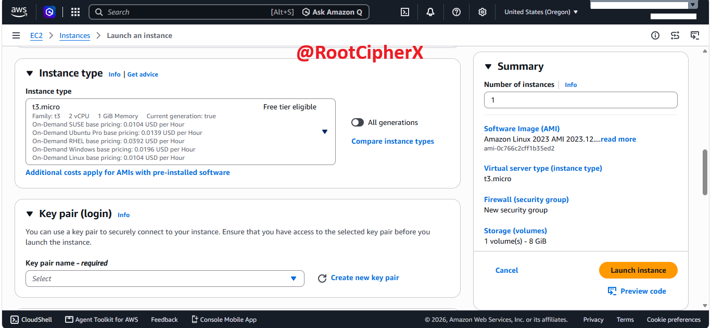

---

### Phase 3: Key Pair Association & Stateful Security Group Rules

Under **Key pair (login)**, initiated cryptographic access configuration[cite: 126].
<br>

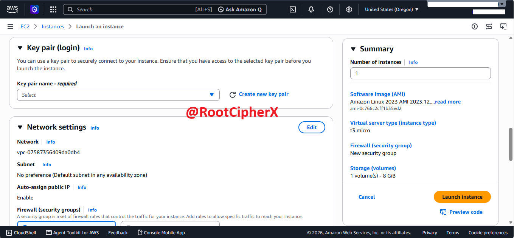

Configured key generation parameters:
* **Key pair type:** RSA (asymmetric private/public key encryption)[cite: 127]
* **Private key format:** `.pem` (OpenSSH compatibility)[cite: 127]
<br>

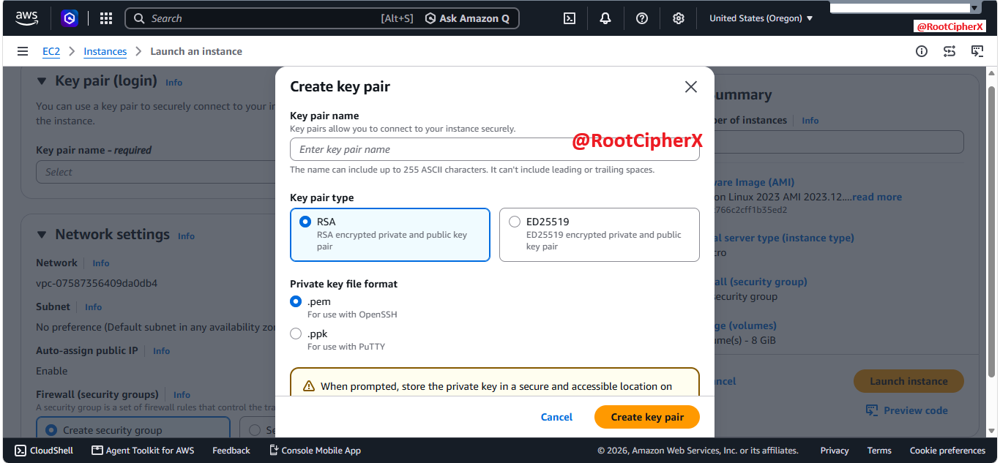

Selected the pre-configured key pair **`Linux-pratu`** from the key catalog dropdown[cite: 128].
<br>

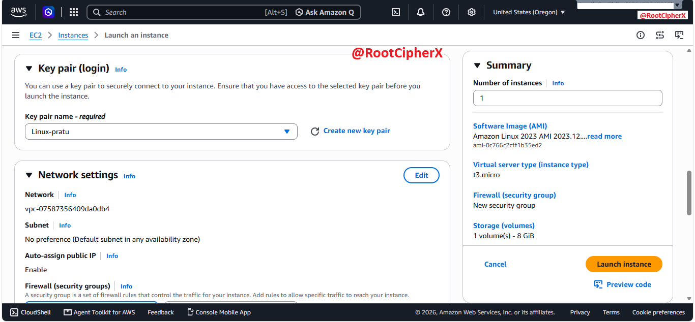

Under **Network settings**, created a new Security Group with inbound firewall rules permitting essential ingress traffic from any source (`0.0.0.0/0`)[cite: 129]:
* **Rule 1 (SSH):** TCP port 22 for administrative command-line access[cite: 129]
* **Rule 2 (HTTP):** TCP port 80 for serving web pages[cite: 129]
<br>

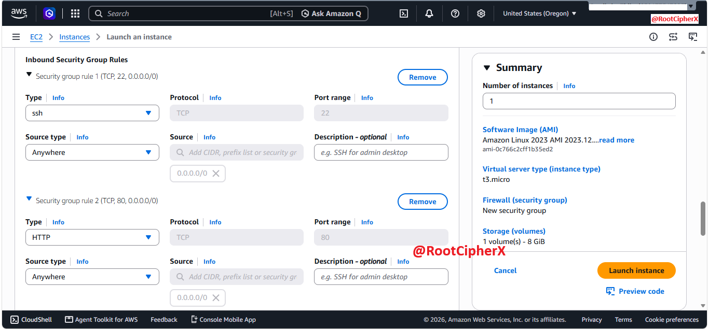

Appended additional inbound rules to allow secure traffic:
* **Rule 3 (HTTPS):** TCP port 443 for encrypted transport[cite: 130]
* **Rule 4 (Custom UDP):** UDP port 22[cite: 130]
<br>

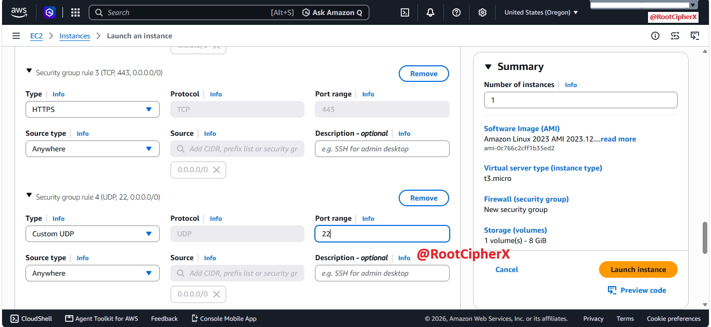

---

### Phase 4: Automated Cloud-Init Bootstrapping (User Data)

Scrolled to **Advanced details** at the bottom of the launch wizard and entered an automated bootstrapping shell script into the **User data** container[cite: 131]:

```bash
#!/bin/bash
yum update -y
yum install -y httpd
systemctl start httpd
systemctl enable httpd
echo "<h1><center>Welcome to My AWS Webserver</center></h1>" > /var/www/html/index.html
```

#### Script Execution Breakdown
1. `#!/bin/bash`: Defines the interpreter for execution by cloud-init during initial kernel boot[cite: 131].
2. `yum update -y`: Synchronizes and refreshes repository package catalogs non-interactively[cite: 131].
3. `yum install -y httpd`: Downloads and installs the Apache HTTP Server and its dependencies[cite: 131].
4. `systemctl start httpd`: Starts the Apache service daemon immediately[cite: 131].
5. `systemctl enable httpd`: Configures the systemd service to persist and start automatically upon system reboots[cite: 131].
6. `echo "<h1><center>Welcome to My AWS Webserver</center></h1>" > /var/www/html/index.html`: Generates the default document served by Apache[cite: 131].

Clicked **Launch instance** to initiate hardware allocation[cite: 131].
<br>

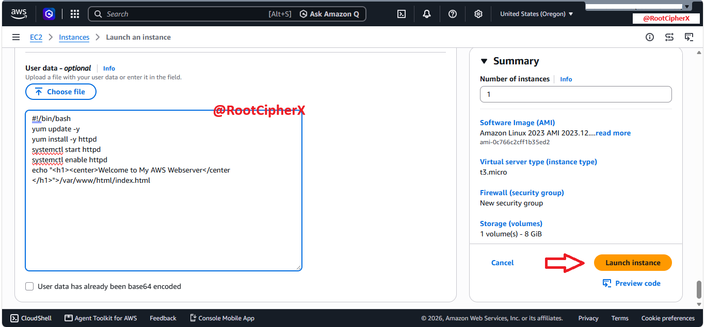

Received launch confirmation: *"Successfully initiated launch of instance (`i-0c1556c9a5297e8b0`)"*[cite: 132].
<br>

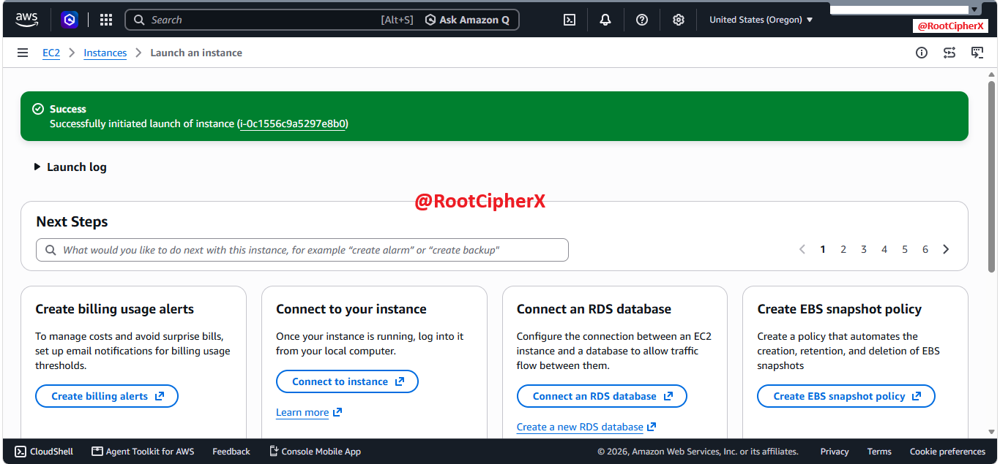

Selected **View all instances** to transition back to the EC2 instances management console[cite: 123].
<br>

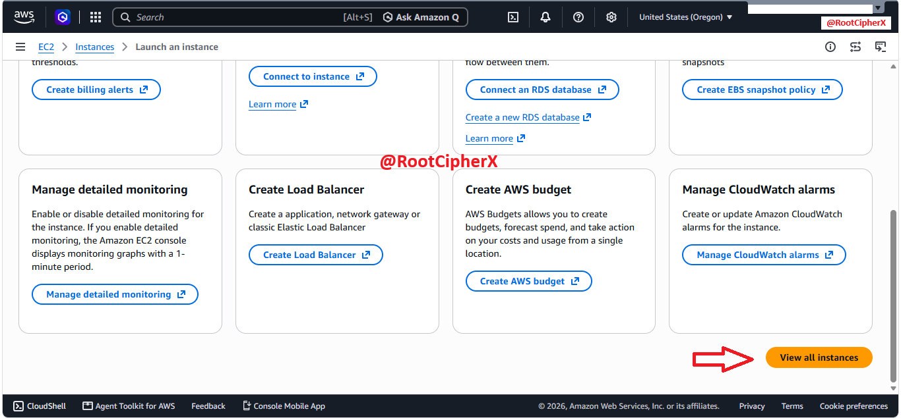

---

### Phase 5: Instance Initialization & HTTP Endpoint Validation

Monitored the instance inventory[cite: 134]:
* **Instance ID:** `i-0c1556c9a5297e8b0`[cite: 134]
* **Instance State:** `Running` (status checks initializing)[cite: 134]
* **Public IPv4 Address:** Auto-assigned public IP address[cite: 134, 135]
* **Private IPv4 Address:** `172.31.31.91` (VPC subnet range)[cite: 134]
<br>

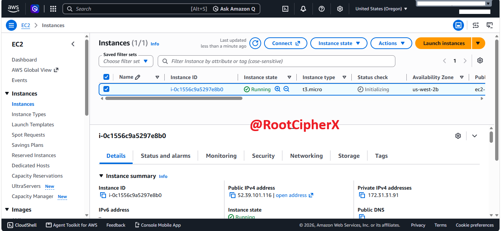

Inspected the comprehensive **Instance summary** metadata, confirming public DNS mappings, VPC ID, and subnet placement[cite: 135].
<br>

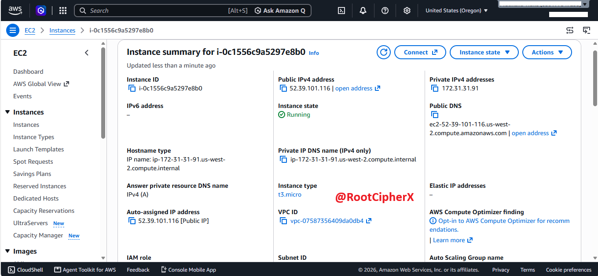

Opened a local web browser and navigated directly to the instance's public IP over HTTP (`http://54.244.57.147`)[cite: 136]. The browser rendered the custom HTML heading:
> **Welcome to My AWS Webserver**[cite: 136]

This confirmed that the User Data script executed cleanly during boot without requiring manual intervention[cite: 131, 136].
<br>

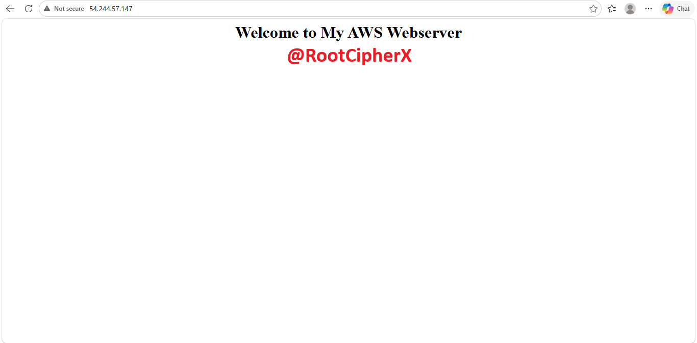

---

### Phase 6: Remote SSH Administration & Terminal File Inspection

Launched **PuTTY** on the administrator desktop to establish secure command-line management[cite: 137]:
* **Host Name:** Target public IPv4 address (`54.244.57.147`)[cite: 137]
* **Port:** `22`[cite: 137]
* **Connection Type:** `SSH`[cite: 137]
* **Auth Credentials:** Associated the private key (`Linux-pratu`)[cite: 128, 138]
<br>

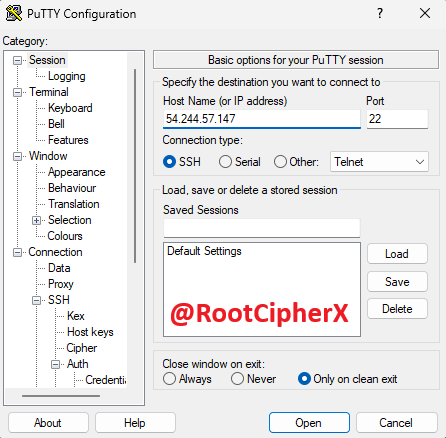

Authenticated as the default administrative user `ec2-user` via public-key cryptography[cite: 138]. Executed fundamental Linux navigation and inspection commands[cite: 138]:
```bash
pwd              # Confirmed home directory: /home/ec2-user
whoami           # Confirmed current user: ec2-user
echo $SHELL      # Confirmed active login shell: /bin/bash
cd /var/www/html # Navigated to the Apache document root
ls               # Verified presence of index.html generated by cloud-init
```
<br>

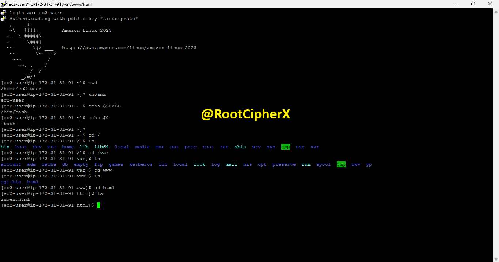

Initiated a graceful system halt directly from the terminal[cite: 139]:
```bash
sudo init 0
```
The operating system issued a broadcast warning: *"The system will power off now!"* and terminated the active transport connection, triggering PuTTY's network disconnect alert[cite: 139].
<br>

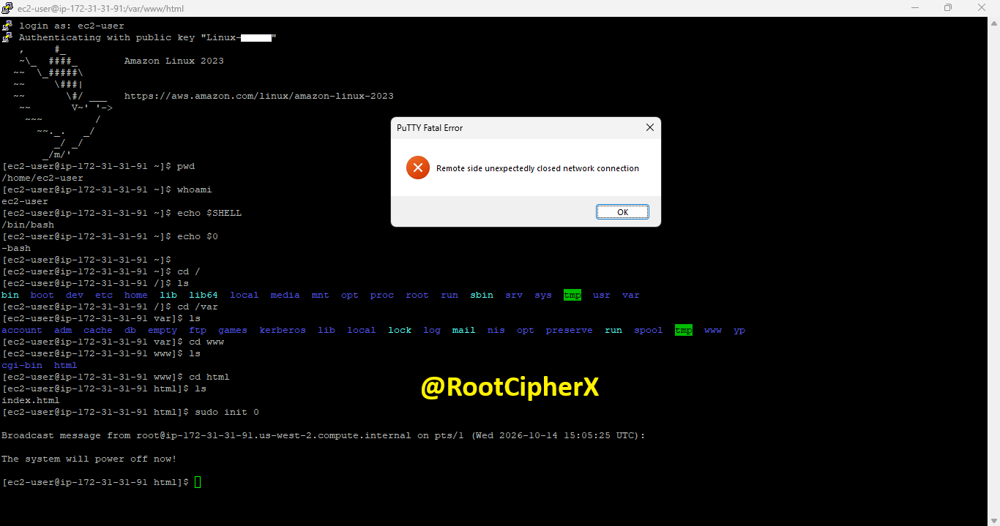

---

### Phase 7: Graceful Host Shutdown & Safe Resource Decommissioning

In cloud environments, stopping or terminating instances when they are not in use is critical to prevent unexpected billing. Selected the target instance in the EC2 console, opened **Instance state**, and selected **Stop instance**[cite: 140].
<br>

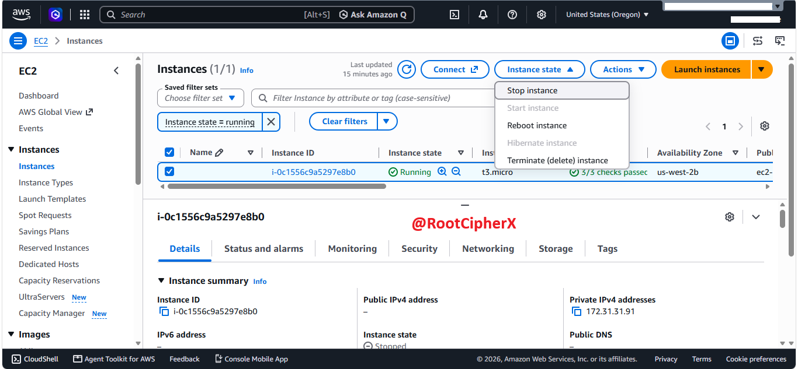

Reviewed the resource confirmation dialogue (which notes that compute billing halts while attached EBS storage remains preserved) and clicked **Stop**[cite: 141].
<br>

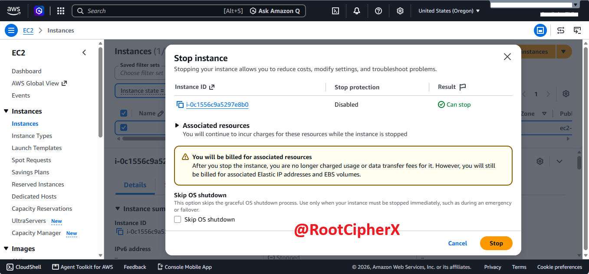

To completely decommission the laboratory and avoid any ongoing EBS volume storage charges, selected **Instance state -> Terminate (delete) instance**[cite: 142].
<br>

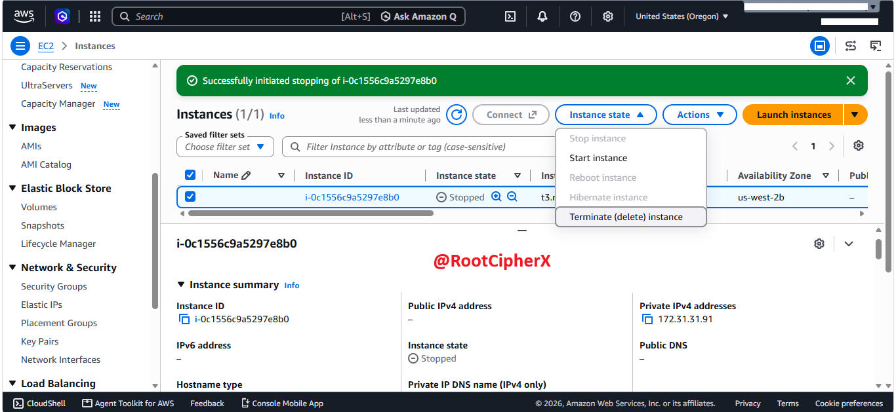

Audited the final deletion modal (confirming the root EBS storage volume will be released and deleted) and clicked **Terminate (delete)**[cite: 133]. The instance transitioned to terminated state, completing a clean lab lifecycle[cite: 133].
<br>

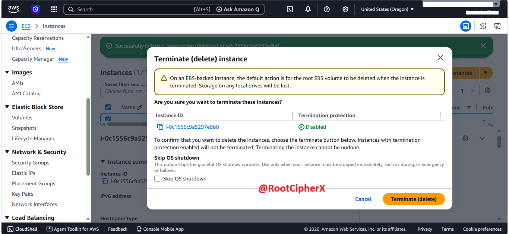

---

## Operational Relevance & Cloud Hygiene

This deployment highlights several key principles of practical cloud infrastructure management:

* **Infrastructure Automation (User Data):** Utilizing `cloud-init` shell scripts eliminates human error during software deployment, ensures idempotency, and forms the basis for Auto Scaling Launch Templates[cite: 131].
* **Stateful Firewall Filtering (Security Groups):** Restricting ingress strictly to intended ports (22, 80, 443) prevents unneeded network exposure across the VPC[cite: 129, 130]. In production environments, SSH port 22 should be further restricted to trusted administrative IPs or replaced by **AWS Systems Manager (SSM) Session Manager** to avoid public-facing management ports entirely.
* **Cost Governance & Resource Teardown:** Cloud engineering requires understanding billing lifecycles. Stopping an instance halts compute costs while retaining the EBS drive; terminating an instance completely removes the virtual machine and releases attached storage to avoid recurring charges[cite: 133, 141].

---

## Ethical Guidelines & Disclaimer
This project was conducted within an authorized personal Amazon Web Services account strictly for cloud systems administration, automation testing, and educational purposes. All deployed resources were safely decommissioned following testing to maintain optimal security and cost hygiene[cite: 133, 142].
